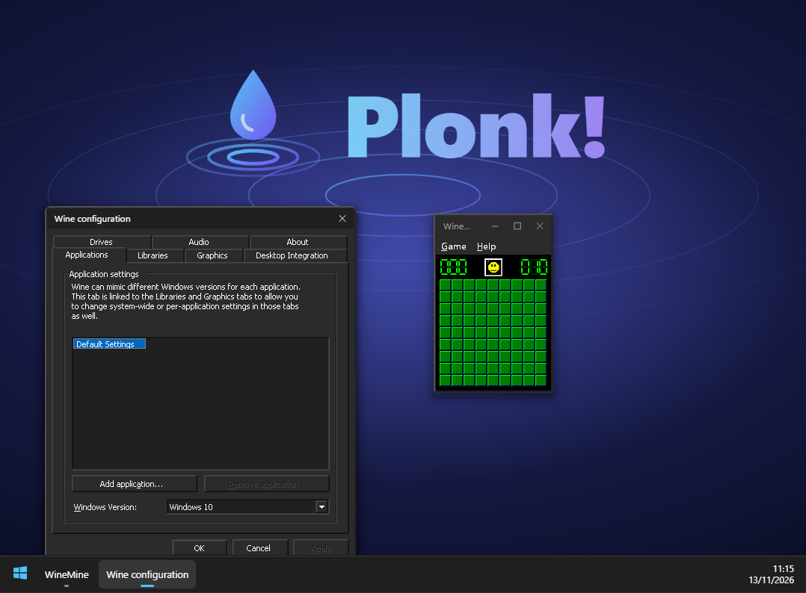

<p align="center"></p>

<p align="center"><b>Real Windows programs, running in a browser tab.</b></p>

<p align="center"></p>

Plonk! runs unmodified 32-bit Windows applications (Notepad, Regedit, mIRC, old DirectX-era games, your own `.exe`) entirely inside a web page. There is no server-side emulation, no streaming and no plugin. It is a small PC built out of WebAssembly: a CPU, a Linux-compatible kernel, and the real [Wine](https://www.winehq.org/) on top.

## Your data stays on your machine

Everything runs **locally, in your browser**. Nothing you do in Plonk! is sent anywhere.

- The web server only hands out static files: the page, the WebAssembly program, the Wine files and a saved boot snapshot. It never sees your programs, files, keystrokes or mouse movements.
- A program you pick with "Run your own .exe…" is read by the page and placed in the emulated machine's memory. It is not uploaded.
- The emulated machine has **no network access**: the kernel implements local (in-machine) sockets only, so a Windows program cannot reach the internet, your network, or your real files.
- There is no analytics, tracking or telemetry in the page.
- The emulated disk lives in memory and is thrown away when you close or reload the tab. That is deliberate.

## What it is made of

```
 Windows program (.exe, 32-bit)
        │  Win32 API
 ┌──────▼────────────────────────────────────────────┐
 │ Wine 9.0 (real, unmodified, built for i386 Linux) │  wine, wineserver, ntdll.so, win32u.so, PE DLLs
 │  + wineplonk.drv  (our display / input driver)    │
 │  + opengl32.dll   (our OpenGL → browser GPU)      │
 └──────┬────────────────────────────────────────────┘
        │  Linux system calls (int 0x80)
 ┌──────▼────────────────────────────────────────────┐
 │ Plonk! kernel  (Rust, crates/host/src/linux.rs)   │  processes, threads, futexes, files, pipes, local sockets
 ├───────────────────────────────────────────────────┤
 │ i386 CPU      (Rust, crates/cpu) block cache + JIT│
 │ Paged memory  (Rust, crates/mem)                  │
 └──────┬────────────────────────────────────────────┘
        │  WebAssembly
 ┌──────▼────────────────────────────────────────────┐
 │ The page (web/real.html)                          │  WebGL2 desktop compositor, 3D backend
 │  taskbar, Start menu, input, themes               │  (WebGPU/WebGL2), HTML taskbar
 └───────────────────────────────────────────────────┘
```

- **The CPU** is an x86 (i386) interpreter written in Rust and compiled to WebAssembly. It decodes code into cached blocks, and hot blocks are translated into WebAssembly functions (see below).
- **The "OS"** is a Linux-compatible personality in the same program. Wine is a Linux program, so instead of booting Linux, Plonk! answers Wine's Linux system calls itself: process creation (`fork`/`execve`/`clone`), threads and futexes, a virtual file system, pipes, Unix sockets, `poll`, shared memory mappings and a scheduler. That is all Wine needs.
- **Wine** is the real thing: the real `wineserver`, real `ntdll`, real `win32u` and the real Windows DLL implementations. Windows behaviour comes from Wine, not from code we wrote. Plonk! only supplies a machine for Wine to run on.
- **The display driver** (`wine/plonkdrv`, `wineplonk.drv`) is a small Wine graphics driver. It hands each top-level window's pixels to the page and feeds mouse and keyboard events back. Wine draws the window contents; the page composes the desktop.
- **3D**: the guest's `opengl32.dll` is replaced by a generated one whose entry points trap into the kernel. The kernel turns the calls into a compact command stream that the page replays on **WebGPU** (or WebGL2) on your GPU.
- **The desktop**: windows are textures composed on the GPU (WebGL2) with rounded corners, borders and shadows. The page draws the Windows 11 style title bars, the taskbar, the Start menu and the clock. Dark or light follows your browser setting (`?theme=dark|light` to force it).
- **Bundled programs**: Wine's own Notepad, Regedit, Minesweeper and Wine config, plus [Microsoft's winfile](https://github.com/microsoft/winfile) (MIT) as the File Manager.

### Starting quickly

Booting Wine takes tens of seconds, so Plonk! does it once ahead of time and stores a **snapshot** of the whole running machine (`wine/snapshot.bin`). The page restores it, which brings the first window up in a few seconds. Wine's files are not all downloaded up front: an index is loaded first, the files the snapshot needs come as one archive, and everything else is fetched the first time a program opens it.

## Performance work so far

Interpreting x86 in WebAssembly is slow by nature (roughly 50–150 million instructions per second), so most of the effort has gone into not wasting them:

- **Block cache.** Code is decoded once into compact instructions grouped into blocks; blocks follow the fall-through path of conditional jumps, and chain to their successors.
- **JIT to WebAssembly.** A block that has run ~40 times is translated into a WebAssembly function working directly on the CPU state and guest memory. The browser compiles it and it is called from then on. Anything unusual at run time (an unmapped page, a page-spanning access, a write to code) falls back to the interpreter at that exact instruction, so results are identical. Compute-heavy code runs about 2× faster; start-up of a large application such as mIRC about 1.5× faster.
- **No pointless cache revalidation.** The kernel's memory writes already go through the tracked path, so the decoded-code cache is kept across system calls instead of being re-checked each time.
- **Memory.** Guest memory is paged and sparse. Pages of DLLs and of the boot snapshot are shared copy-on-write between processes, shared file mappings are really shared, and an exited process gives all its memory back. Wine's files are loaded on demand. A restored session sits at roughly 170 MB.
- **Snapshots** instead of booting (see above), and parallel downloads of the page's assets.
- **GPU composition.** Only the changed rectangle of a window is uploaded; windows are drawn as textured quads. 3D frames are drawn several per browser turn and handed to the screen without a read-back.
- **Compiler settings.** One codegen unit, `panic = "abort"`, hot accessors force-inlined, WebAssembly bulk-memory/SIMD enabled.

Useful switches (URL parameters): `?nojit`, `?cpu` (CPU composition instead of the GPU), `?incanvas` (draw 3D into the desktop canvas instead of its own overlay), `?theme=`, `?gl=webgl2`, `?nodpi`.

## Known limits and how it could improve

- **JIT coverage.** Floating point (x87), SSE, string instructions (`rep movs`), `adc`/`sbb` and segment moves still go through the interpreter. Larger translated regions (jumping between blocks inside WebAssembly) and lazy flag evaluation would cut the per-block overhead, which is now the main cost.
- **Controls look classic.** Window frames, title bars and the taskbar are modern, but buttons, tabs and scrollbars inside applications are Wine's classic ones, recoloured. Flat Windows 11 controls need a visual-style (msstyles) theme. Captions of MDI child windows are still drawn by Wine.
- **No network and no sound.** Both are deliberate gaps rather than finished features. Networking, if ever added, would need a clear opt-in, because it breaks the "nothing leaves your machine" guarantee. Audio output is simply not implemented.
- **Signals and page protection** are not delivered to guest programs, a few Wine background services (COM server, device manager, shell menu builder) are switched off for speed, and some applications may need more of them.
- **Old DirectX games** depend on Wine's DirectDraw/Direct3D, which expect a full OpenGL; our OpenGL layer is deliberately small. Some games need Wine's software renderer or further work.
- **Start-up.** The first run downloads the Wine files it needs (tens of megabytes, compressed). More aggressive prefetching and finer-grained snapshots would shorten the first launch.
- **Memory.** A mapped file is still held twice (its contents plus shared page copies); fixing that would save more.

## Building and running

You need Rust (with the `wasm32-unknown-unknown` target) and, for the Wine build, a Debian/Ubuntu environment (WSL works) with an i386 toolchain. Nothing else: the web server is a small Rust program in this repository, so Node.js is not needed to run Plonk! (a few developer test scripts in `web/*.mjs` still use it for headless-browser checks).

```sh
# the WebAssembly program
cargo build --release -p plonk-host --target wasm32-unknown-unknown

# Wine for i386 + the Plonk! driver, packed into wine/root.tar (see the scripts' headers)
wine/build32.sh          # inside Debian/WSL
wine/repack.sh

# a saved Wine prefix and boot snapshot
cargo run --release -p plonk-host --example linuxrun -- /usr/local/bin/wine /home/user/keeper.exe   # see the example's header for the env knobs

# serve it
cargo run --release -p plonk-serve   # then open http://localhost:8080/  (optional argument: a port)
```

Large generated files (`wine/root.tar`, `wine/prefix.tar`, `wine/snapshot.bin`) are not checked in. Design notes are in `docs/`; the OpenGL command protocol is in `docs/GL_PROTOCOL.md`.

## Credits and licences

Plonk! stands on others' work: [Wine](https://www.winehq.org/) (LGPL), [winfile](https://github.com/microsoft/winfile) (MIT, Microsoft), the Selawik font (SIL Open Font License), plus the Rust and WebAssembly toolchains. Their licence files are kept alongside the respective sources in this repository.
